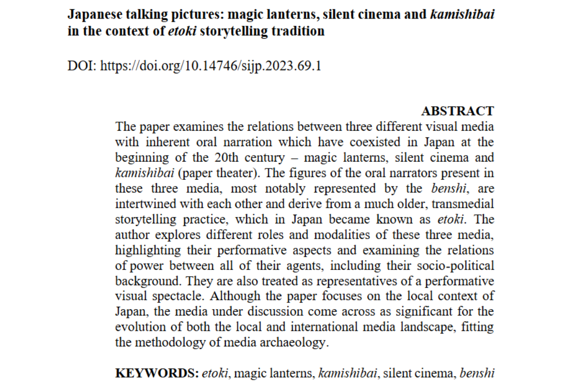

[Read in Silva Iaponicarum](https://pressto.amu.edu.pl/index.php/silvajp/article/view/43874)

The paper examines the relations between three different visual media with inherent oral narration which have coexisted in Japan at the beginning of the 20th century – magic lanterns, silent cinema and kamishibai (paper theater). The figures of the oral narrators present in these three media, most notably represented by the benshi, are intertwined with each other and derive from a much older, transmedial storytelling practice, which in Japan became known as etoki. The author explores different roles and modalities of these three media, highlighting their performative aspects and examining the relations of power between all of their agents, including their socio-political background. They are also treated as representatives of a performative visual spectacle. Although the paper focuses on the local context of Japan, the media under discussion come across as significant for the evolution of both the local and international media landscape, fitting the methodology of media archaeology.
