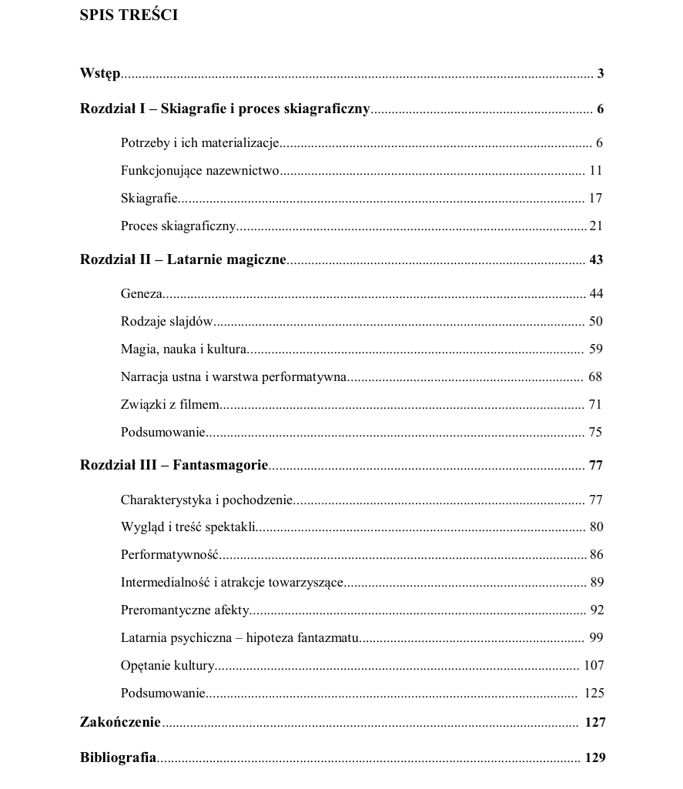

[Read in the Jagiellonian University Repository](https://ruj.uj.edu.pl/entities/publication/bbdd1eab-e06a-4d58-a85f-25f65d51b97a)

The goal of the study is to depict medial genealogy, which is most vividly represented by cinema for the last hundred years, and also to discuss in detail two media essential for this genealogy — magic lanterns and their specific form, called phantasmagoria.

The first chapter of the paper describes propositions of such “pre-cinematic” media classification already existing in literature of the subject, pointing out their flaws and their growing obsolescence. The author proposes his own cinema genealogy, based on assumptions of media archaeology and apparatus theory, and deriving its name from an ancient Greek painting type — skiagraphia. Because of the submitted discriminants, the author recognizes cinema as an element of the skiagraphic process: a visual spectacle tradition, dating back to prehistory, which is constantly updated with new technological incarnations across the centuries. Specific media and phenomena included in the process are enumerated and discussed.

The second chapter focuses on magic lanterns, which constitute one of the key stages of the skiagraphic process. The author discusses the origins and most important attributes of magic lanterns, their performative values and connections to early cinema. A lot of emphasis has been put on the narrative capabilities of images produced by the lanterns.

The third chapter analyzes a specific variant of magic lantern shows — the phantasmagoria. Apart from the most important attributes, the author, based on the exceptional spectacle conditions and the state of psychological knowledge at their time, proposes a modification of apparatus theory applicable to the phantasmagoria. Along with other media, phantasmagoria are discussed in the context of semantics and pragmatics. Using examples of Polish and global literature, the author analyzes their impact on shaping cultural imagination.
