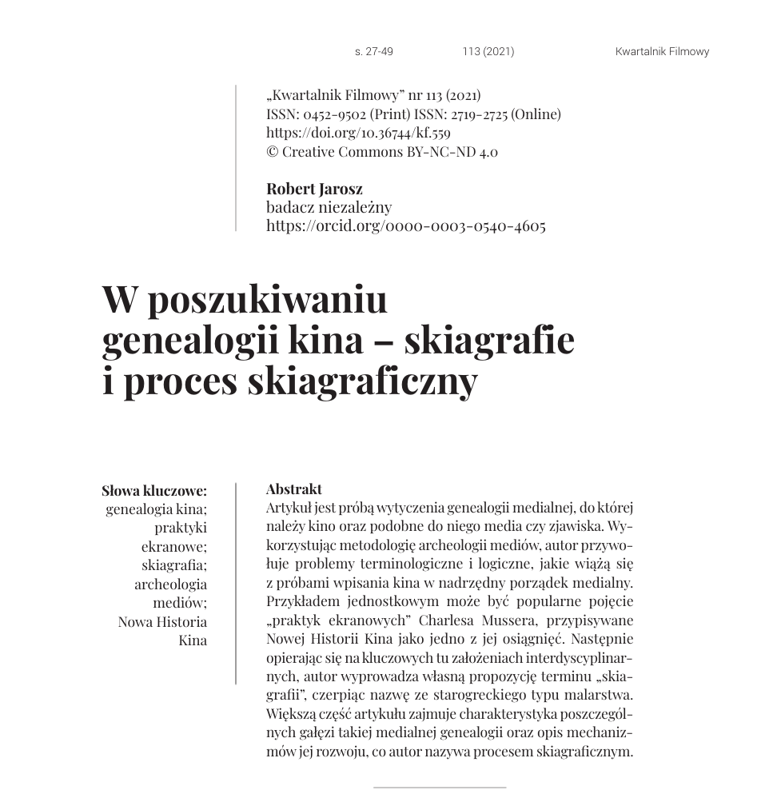

[Read in Kwartalnik Filmowy](https://czasopisma.ispan.pl/index.php/kf/article/view/559)

The article is an attempt to trace the media genealogy to which cinema belongs, along with media and phenomena like it. Using the methodology of media archaeology, the author recalls the terminological and logical problems that come with trying to set cinema inside a higher-order media framework. One particular example is Charles Musser’s widely used notion of “screen practices,” credited to New Cinema History as one of its achievements. Then, drawing on the interdisciplinary assumptions that are central here, the author offers his own term, “skiagraphy,” taking the name from an ancient Greek kind of painting. Most of the article describes the separate branches of this media genealogy and the mechanisms of its development, which the author calls the skiagraphic process.
