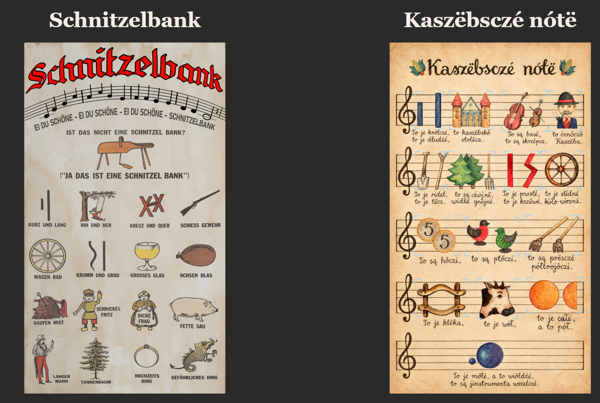

# [Play Schnitzelbank](https://schnitzelbank.glimpsegaze.com)

**Schnitzelbank** is an interactive songboard for a pictorial singing game. The German board sets the familiar *Schnitzelbank* — “Ist das nicht eine Schnitzelbank?” — as a sheet of pictures that stand in for the words: a wheel, a glass, a pig, a ring, a crooked line. Beside it, **Kaszëbsczé nótë** does the same work in Kashubian, with its own drawings written onto the staff.

The song can be listened to, with a hand that points along the pictures as the verse advances. It can also be played. A frame travels to the next picture, and the answer is to click that picture when the frame meets it. The lyric line and the drawing stay locked together, so the rebus is something you perform rather than a chart you only read.

The two boards keep the same idea in two languages. Each is a cumulative picture-song: the caller names a thing, the answer confirms it, and the pictures carry the memory of the verse. The piece is a way of putting that oral form back into the hands of a listener.
