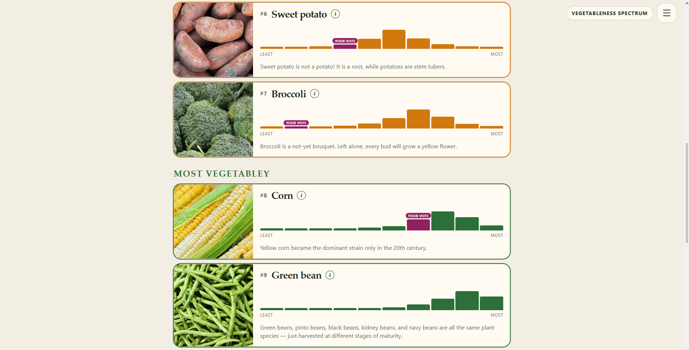

# [Take the Vegetable Survey](https://vegetable.glimpsegaze.com)

**The Great Vegetable Survey** is a short, interactive study of a word that feels obvious until you try to define it. *Vegetable* is a kitchen idea as much as a botanical one, and the point is to record what people actually mean by it: the first plant that comes to mind, the reasons they give, how they sort the awkward cases, and the definition they are willing to write down. There are no wrong answers. A tomato can campaign all it likes.

The questionnaire takes about seven minutes and uses a different interaction for each question, so the way you answer is part of the measurement. You type a first association, pick the criteria that make something vegetabley (and add your own, if you dare), then drag the grey zone into piles: not a vegetable, in-between, or definitely one. Roots, flowers, seeds, and botanical fruits all turn up, still sitting somewhere on a kitchen table. After that you rank ten of them on a **vegetableness spectrum**, from least to most vegetabley, and crown the single **most vegetable vegetable**. A longer note at the end is your chance to settle the argument in prose. Birthplace and native language are optional, and nothing asks for a precise location.

Finish, and the survey hands you a private ranking code. Reopen it later, or send it to someone who is wrong about green beans. Your order can sit next to the wider pattern instead of vanishing into a form you will never see again. The results are a set of boards you can actually play with: rankings, bucket columns, spectrum bands, open notes, and custom reasons. Once you have completed the survey on that device, you can like a public note or sink it. English and Polish stay in separate pools, so a definition written in one language is not graded by the other.

The long game is geographic. Optional birthplace and language are there to test whether this folk category follows cuisines and languages, or merely the supermarket shelf. A world map in an equal-area projection shows where answers are coming from. Place and language filters open once enough people from that area have weighed in, so a lonely ballot cannot pretend to speak for a whole region. Until then, the global boards are where the sweet potato and the green bean keep having it out.

The project treats a folk category as something you can explore, argue with, and compare. Take the survey, defend your spectrum, and see whether the rest of the world agrees.
